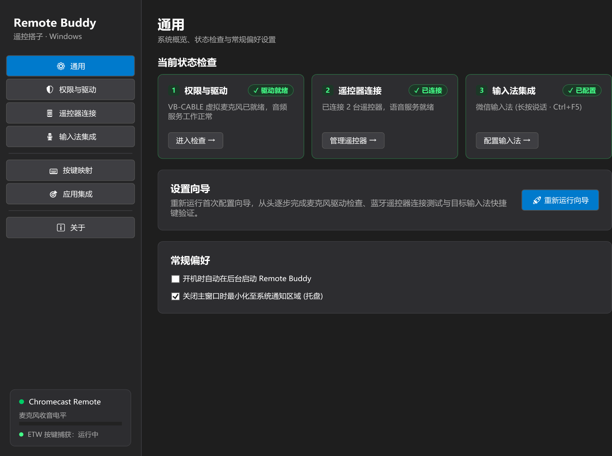
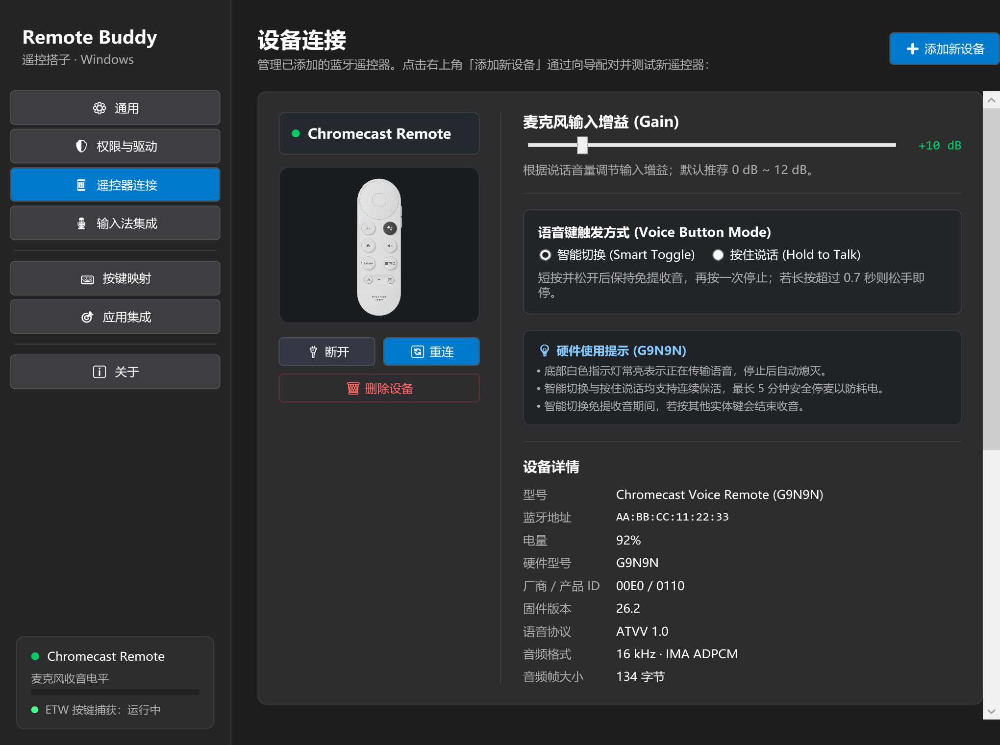
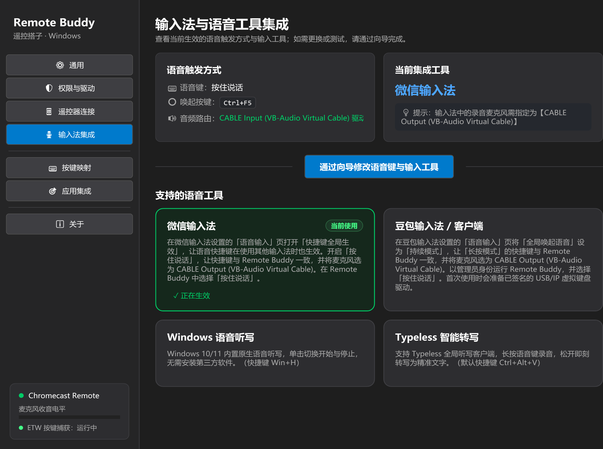

# Remote Buddy (Windows)

Remote Buddy（遥控搭子）Windows 版把蓝牙电视遥控器变成 Windows 10 / 11 上的全局语音输入与快捷控制工具。拿起遥控器说话、松开结束，把语音直接送入微信输入法、豆包输入法、Windows 系统听写或 Typeless 等输入工具，同时支持自定义普通按键快捷键、媒体控制与常用文本。

[产品官网](https://remote.zfdang.com) · [官网下载](https://remote.zfdang.com/downloads/index.html#platform-windows) · [GitHub Releases](https://github.com/zfdang/remote-buddy-windows/releases/latest) · [设备选购指南](https://remote.zfdang.com/device.html) · [Windows 使用指南 (FAQ)](https://remote.zfdang.com/faq.html#windows-guide)

> 🍎 **macOS 原生版**：如果你正在寻找 macOS 版本，请移步原创项目 **[remote-buddy (macOS 版)](https://github.com/zfdang/remote-buddy)**（基于原生 Swift / AppKit 与自研 `Remote Buddy Mic` CoreAudio 驱动）。本项目为 **remote-buddy 的同源 Windows 10/11 原生移植版本**，纯软件直连电脑内置蓝牙，无需额外 USB 硬件接收器。

---

## 界面预览

> 截图使用示例设备与虚拟驱动就绪状态展示界面布局。

### 通用



---

### 设备连接



---

### 输入法集成



---

## 核心特性

- **零额外硬件，内置蓝牙直连**：直接通过 Windows 10/11 原生 WinRT 低功耗蓝牙（BLE GATT）连接小米遥控器、Google Chromecast 遥控器等设备，无需购买或插拔 2.4G 接收器。
- **低延迟音频管线与防吞字保护**：完整实现 ATVV 语音协议状态机（含 `AUDIO_SYNC` 校准与动态 `SessionID` 管理），纯 C# 内存级解码 16 kHz / 16-bit 单声道 IMA ADPCM 音频，配合 WASAPI Pre-roll（首音预存）与 Drain（尾音排空）保护，避免输入法吞掉首字或截断尾句。
- **适配主流中文与系统输入工具**：支持微信输入法、豆包输入法 / 客户端（内置签名 USB/IP 虚拟键盘驱动以适配豆包长按判定）、腾讯 Chatterfly、Typeless、Windows 自带语音听写（`Win + H`）及其他自定义全局快捷键语音工具。
- **多遥控器共存与按键自定义**：支持多只遥控器同时连接并按物理实体隔离配置（各自维护单击、双击、长按映射，可发送快捷键、媒体键或常用文本；语音通道按先行占用原则使用）。
- **8 步式新手向导与驱动辅助**：覆盖 VB-CABLE 驱动检测与一键安装、蓝牙扫描配对、按键实测、收音波形测试、输入工具选择及真实转写验收，减少初次排查成本。
- **纯本地运行、零隐私采集**：不保存任何录音文件或识别文本历史，不包含遥测或第三方统计 SDK（日志仅保留于本地）。

---

## 快速上手

1. **下载并完整解压**：前往 [官网下载页](https://remote.zfdang.com/downloads/index.html#platform-windows) 或 [GitHub Releases](https://github.com/zfdang/remote-buddy-windows/releases/latest) 下载 `Remote_Buddy_Windows_*_x64.zip`（自包含单文件绿色版，基于 .NET 10 LTS 发布，无需另装运行库），将其**完整解压**到固定目录（例如 `D:\Tools\RemoteBuddy`）。
2. **以管理员身份运行**：右键点击 `RemoteBuddy.App.exe` 选择**「以管理员身份运行」**（首次运行若出现 SmartScreen 提示，可点击「更多信息 → 仍要运行」）。
   > 💡 **为什么推荐管理员权限**：
   > - 通过 **BthPort ETW** 内核事件完整捕获 Chromecast G9N9N 普通按键以及小米 RC003 的返回、音量加减键；
   > - 为**豆包输入法**提供已签名的 USB/IP 虚拟键盘注入（绕开 `LLKHF_INJECTED` 过滤）；
   > - 跨越 Windows **UIPI** 权限隔离，向管理员终端或提权应用窗口正常注入快捷键；
   > - 支持在向导内安装驱动或重启异常的蓝牙适配器。
3. **安装 VB-CABLE 虚拟麦克风并重启 Windows**：在向导第 2 步或主界面「权限与驱动」中点击**「安装 VB-CABLE」**（应用会优先从官网镜像下载固定校验的 `VBCABLE_Driver_Pack46.zip` 并支持 VB-Audio 官网回退），在安装器中选择 `Install Driver` 后**重启电脑**。
   > 若安装后系统扬声器无声，只需点击任务栏音量图标，将 Windows 默认**播放输出设备**从 `CABLE Input` 切回你的物理扬声器或耳机即可。
4. **配对并在应用内连接遥控器**：先在 Windows 蓝牙设置中配对遥控器（或通过向导扫描），随后**务必在向导或「遥控器连接」页面点击对应设备的「连接」**以建立 ATVV 语音服务。
5. **设置麦克风并验收**：在目标输入法中选择 `CABLE Output (VB-Audio Virtual Cable)` 作为录音麦克风，保持语音快捷键与向导一致，完成一次「语音转写验收」即可开始使用。

更详细的故障排查（如配对无响应、输入法设置、按键附加映射机制等）请参阅 **[Windows 平台安装与使用指南 (FAQ)](https://remote.zfdang.com/faq.html#windows-guide)**。

---

## 遥控器支持与 Windows 验证范围

| 型号 | 普通键在 Windows 上的采集方式 | 语音与实机状态 |
| :--- | :--- | :--- |
| **Google Chromecast 遥控器（G9N9N）** | 实测主要依赖 BthPort ETW，从设备的 HID over GATT 通知解码普通键；也兼容有来源句柄的 Raw Input / HID 事件 | ATVV（默认智能切换免提 + 最长约 5 分钟保活）。Windows 11 已验证语音与多枚普通键 |
| **小米蓝牙遥控器 2 Pro（RC003）** | 方向键、确认、主页等走 Raw Input 键盘事件；ETW 补取 Windows 未交付给 Raw Input 的返回、音量加和音量减 | ATVV（按住说话，受固件约 60 秒上限约束）。Windows 11 已验证语音和按键（含上述三个补取键） |
| **小米蓝牙遥控器 2（RC001）** | 具备小米设备处理路径，具体键位报告待独立验证 | ATVV。Windows 真机验收待补 |
| **Google TV Streamer 遥控器（GY3LE）** | 代码包含型号与 ETW/HID 采集路径，覆盖范围待独立验证 | ATVV 兼容。Windows 真机验收待补 |
| **T1 飞鼠键盘语音遥控器（T1-Remote）** | 具备 `T1RemoteProtocol` 报告解码路径，背面全键盘与飞鼠原生直通 | ATVV（点按免提）。Windows 真机验收待补 |

Windows 11 已实机验证一只 RC003 与一只 G9N9N 同时连接共存：两只遥控器的普通键各自使用独立映射，语音通道按先行占用原则工作。详细实测记录与排查顺序见 [Windows 遥控器输入实现](docs/windows-remote-input.md)。

---

## 支持的输入法与语音工具

> 通用前置要求：在目标输入法或系统录音设置中将麦克风设为 **`CABLE Output (VB-Audio Virtual Cable)`**。

| 工具 | 推荐触发与快捷键 | 集成说明 |
| :--- | :--- | :--- |
| **微信输入法（WeType）** | 按住说话 · 默认 `Ctrl + F5` | 在微信输入法「语音输入」设置中开启「快捷键全局生效」与「按住说话」，麦克风设为 `CABLE Output` |
| **豆包输入法 / 客户端** | 按住说话 · 默认右 Alt (`RAlt`) | 在豆包中将「全局唤起语音」设为「持续模式」并保持左右修饰键完全一致；需**以管理员身份运行** Remote Buddy 以启用签名 USB/IP 虚拟键盘（详见 [豆包配置指南](docs/doubao-voice-hotkeys.md)） |
| **腾讯 Chatterfly** | 按住说话 · 默认 `Ctrl + Shift + V` | 在 Chatterfly「设置 → 语音设置」中保持快捷键一致并开启「快捷键全局可用」，麦克风设为 `CABLE Output` |
| **Typeless 智能转写** | 按住说话 · 默认 `Ctrl + Alt + V` | 支持全局听写快捷键唤醒 |
| **Windows 语音听写** | 单击切换 · `Win + H` | Windows 10/11 原生内置免安装，将系统默认输入设备设为 `CABLE Output` |
| **其他语音工具** | 自定义快捷键 | 不限定具体工具；设定触发方式与快捷键后，通过向导检测框实测语音识别文本即可适配 |

---

## 架构与技术栈

```text
普通键 → Raw Input／直接 HID 或 BthPort ETW → 按蓝牙设备地址路由 → 单击 / 长按 / 双击映射
语音键 → BLE GATT 的 ATVV 控制通知 → 取得语音占用 → SendInput 或 USB/IP 虚拟键盘快捷键
麦克风 → ATVV 音频通知 → IMA ADPCM 解码 → WASAPI → VB-CABLE 虚拟麦克风 → 输入法
```

| 模块 | 实现方案 |
| :--- | :--- |
| **运行时与语言** | **.NET 10 LTS** (C# 13) |
| **桌面界面** | **WPF** + [WPF-UI](https://github.com/lepoco/wpfui)，使用自包含单文件绿色 `.zip` 发布 |
| **蓝牙通信** | Windows 10/11 原生 WinRT BLE API (`Windows.Devices.Bluetooth`) |
| **音频解码与推流** | 纯 C# IMA ADPCM 解码器（含 `AUDIO_SYNC` 校准）+ [NAudio](https://github.com/naudio/NAudio) WASAPI Render 推流 |
| **虚拟麦克风** | [VB-CABLE](https://vb-audio.com/Cable/)（WHQL 认证虚拟声卡；应用内支持下载校验与引导安装） |
| **按键捕获与注入** | Win32 `RegisterRawInputDevices` / `SendInput`（40 字节 x64 对齐）、BthPort ETW Event 402，以及面向豆包的 `HIDMaestro` / `usbip-win2` USB/IP 虚拟键盘 |

---

## 项目文档

- [Windows 遥控器输入实现](docs/windows-remote-input.md)：对照小米 RC003 与 Chromecast G9N9N 的普通键、语音信号、设备绑定与多遥控器并发规则
- [豆包语音快捷键与 USB/IP 虚拟键盘](docs/doubao-voice-hotkeys.md)：说明豆包对 `LLKHF_INJECTED` 的过滤机制、USB/IP 虚拟键盘路径与验收步骤
- [虚拟音频与驱动集成方案](docs/virtual-audio-and-driver.md)：Windows DSE 驱动签名约束、VB-CABLE 状态检测流转与 WASAPI 推流设计
- [按键监听与快捷键注入规范](docs/input-and-hotkeys.md)：Raw Input 监听与附加映射边界、Pre-roll / Drain 时序保证及 UIPI 权限说明
- [小米 RC003 按键与 Windows 报告](docs/xiaomi-rc003-buttons.md)：Raw Input 键码、ETW 补取键及默认映射
- [G9N9N 按键与 Windows 报告](docs/g9n9n-buttons.md)：HID 索引、Consumer Usage、智能切换模式及默认映射
- [ATVV 协议参考](docs/device-protocols.md) · [软件架构](docs/architecture.md)

---

## 外部依赖、参考项目与致谢

### 外部依赖与运行组件

| 组件 | 版本 | 许可协议 | 用途与分发说明 |
| :--- | :--- | :--- | :--- |
| **[CommunityToolkit.Mvvm](https://github.com/CommunityToolkit/dotnet)** | `8.4.0` | MIT | MVVM 源生成与命令绑定基础设施 |
| **[WPF-UI](https://github.com/lepoco/wpfui)** | `4.0.3` | MIT | 现代 Fluent 风格 WPF 控件与主题样式 |
| **[NAudio](https://github.com/naudio/NAudio)**（`NAudio.Wasapi` / `NAudio.Core`） | `22.0.0` / `2.2.1` | MIT | WASAPI 虚拟音频设备枚举、状态审计与低延迟音频推流 |
| **[HIDMaestro](https://github.com/hifihedgehog/HIDMaestro/releases/tag/v2.3.0)** | `2.3.0` | MIT | 构建期自动下载并校验 SHA-256，用于通过 USB/IP 接口创建豆包所需的硬件级虚拟键盘 |
| **[usbip-win2](https://github.com/vadimgrn/usbip-win2/releases/tag/v.0.9.8.1)** | `0.9.8.1` | BSD-2-Clause | 经微软签名的 Windows USB/IP 主机控制器驱动（随 HIDMaestro 配合用于豆包输入法） |
| **[VB-CABLE Virtual Audio Device](https://vb-audio.com/Cable/)** | Pack 46 | Donationware（VB-Audio Software） | 微软 WHQL 认证虚拟音频线驱动；**本仓库及安装包不打包或二次分发 VB-CABLE**，由用户按其自身许可独立安装 |

完整的第三方版权声明、许可证全文及对应源码归档链接请参阅 **[THIRD_PARTY_NOTICES.md](THIRD_PARTY_NOTICES.md)**。

### 参考项目与致谢

本项目在 Windows 平台实现蓝牙电视遥控器低延迟语音输入与按键捕获的过程中，参考并汲取了以下开源项目的经验与设计：

1. **[remote-buddy (macOS 原生版)](https://github.com/zfdang/remote-buddy)**：Remote Buddy 原创 macOS 项目，定义了完整的 ATVV 协议状态机、防吞字时序、交互向导与产品界面设计；
2. **[MoteDeck](https://github.com/HZDavy/MoteDeck)**：启发了 Windows 下蓝牙遥控器系统消息交互与按键映射的探索；
3. **[windows-remote-mic-app](https://github.com/BenjmSek/windows-remote-mic-app)**：为 Windows 下 BthPort ETW Event 402 内核事件捕获、HID GATT 分析及豆包注入机制研究提供了重要参考。

---

## 从源码构建与测试

开发环境需要 **Windows 10 / 11** 与 **.NET 10 SDK**（构建 `RemoteBuddy.Platform.Windows` 时会通过 MSBuild 自动下载并校验 `HIDMaestro-v2.3.0.zip`）：

```powershell
# 还原、编译并运行全部单元测试
dotnet test RemoteBuddy.sln -c Release

# 或使用构建/测试脚本
.\scripts\build.ps1
.\scripts\test.ps1
```

发布包通过 GitHub Actions 工作流使用 `dotnet publish -c Release -r win-x64 --self-contained true -p:PublishSingleFile=true` 生成免安装 `.zip` 压缩包（附带 `LICENSE` 与 `THIRD_PARTY_NOTICES.md`）。

---

## 开源许可

本项目以 **[GPL-3.0-only](LICENSE)** 开源发布。
